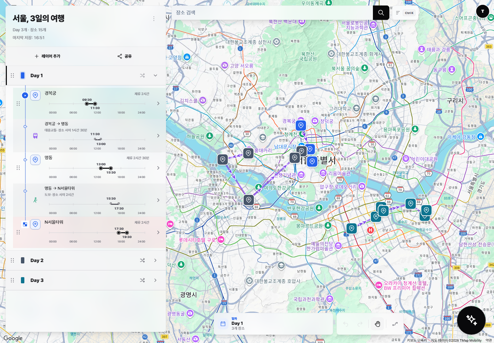
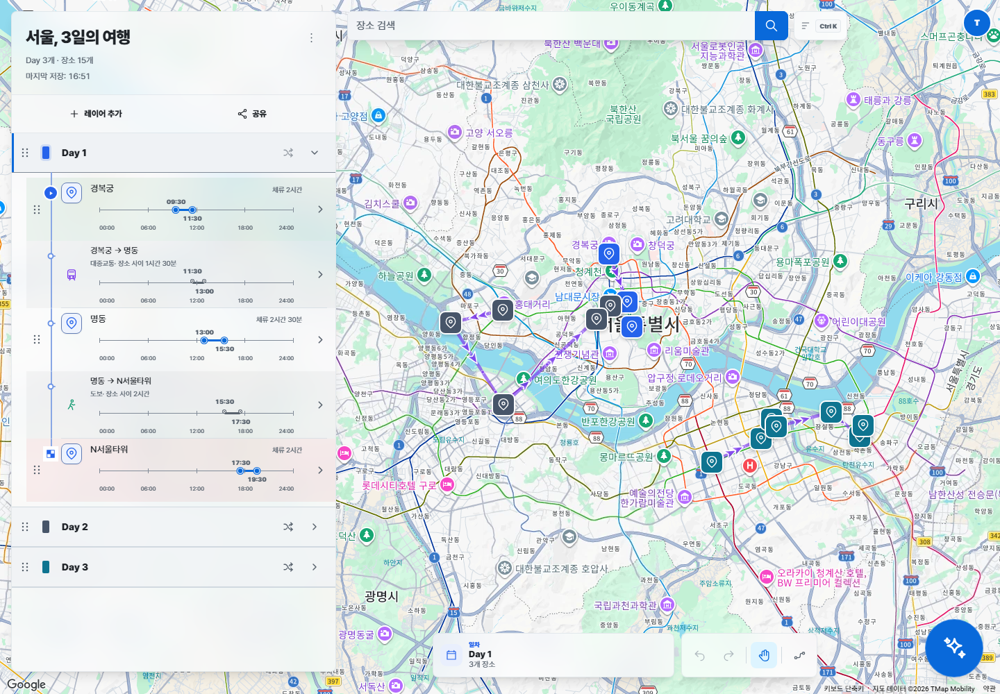
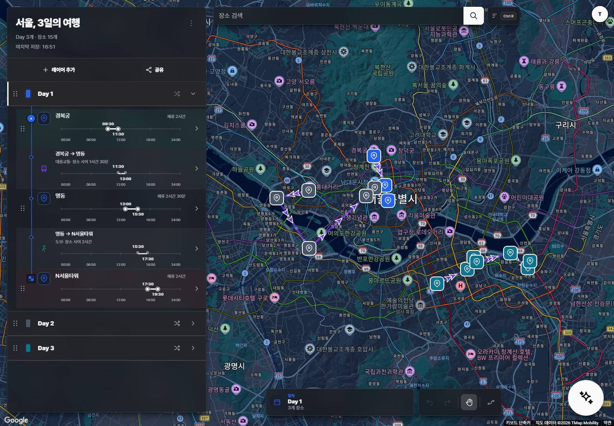
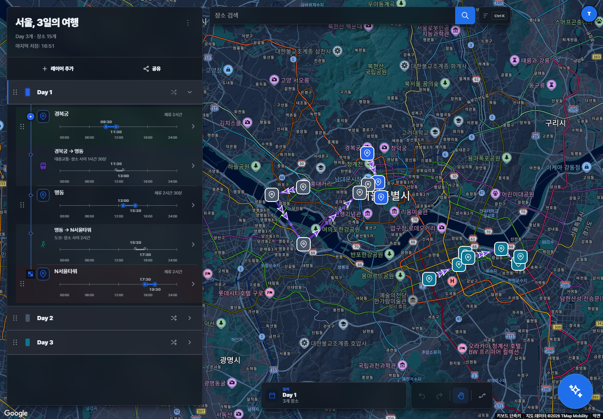
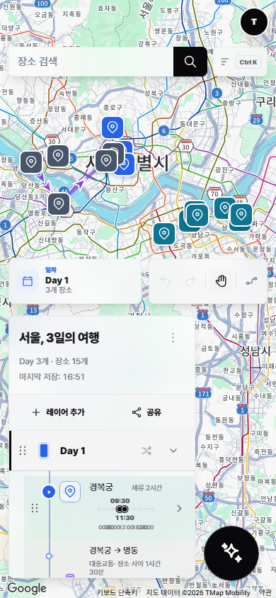
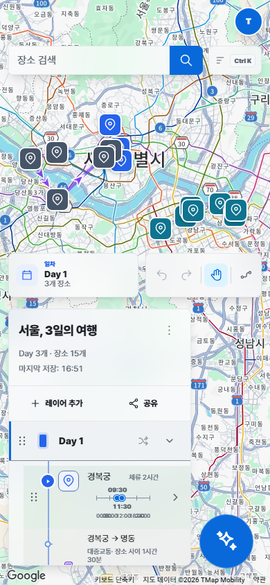
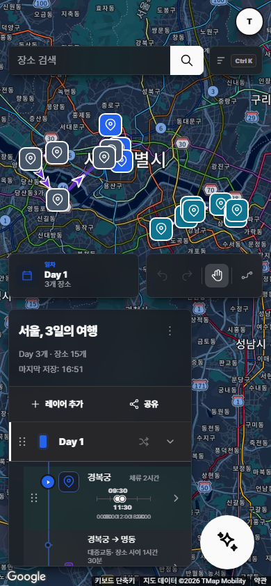
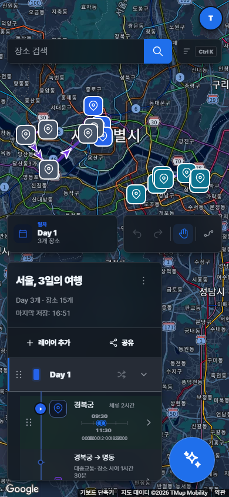

# Primer palette audit

The migration below records the original Primer baseline. As of 2026-11-11,
`app/styles/theme/refined-surfaces.css` follows the light/dark adapter imports
and customizes semantic surface, interaction and foreground tokens. The base
Primer tokens remain available; this historical audit does not claim that the
current neutral palette is an unmodified Primer or Apple system palette.

## Scope and start snapshot

This audit covers a color-only migration from the existing TRIP-derived
Trasolve UI to GitHub Primer functional color tokens. TRIP typography, spacing,
radii, shadow geometry, layout, responsive behavior, and component structure
remain the source of truth. User-selected day, layer, marker, polyline, and data
visualization colors are outside this migration.

The following state was recorded before any source edit. No checkout, reset,
stash, merge, or rebase was performed.

| Item | Recorded value |
| --- | --- |
| Trasolve branch | `impl` |
| Trasolve start HEAD | `38cc844502621c7f2b15fe3989708b38ecf87e84` |
| Worktree | clean |
| `main...impl` | `0 26` (0 behind, 26 ahead) |
| Upstream | `impl...origin/impl` |

The supplied older `fa9eb13d...` baseline no longer matched the checkout. The
actual branch and HEAD above were retained.

## Fixed Primer source

| Item | Fixed reference |
| --- | --- |
| Repository | `https://github.com/primer/primitives` |
| npm package | `@primer/primitives@11.10.0` |
| Git tag | `@primer/primitives@11.10.0` |
| Tag commit | `3f51f80ee9510974032917c9b8ac9586656c88bc` |
| Annotated tag object | `4140478c2788fadffed10a7443c2342f31ce2dea` |
| npm tarball SHA-1 | `affc83ae02229e05dbc599d9903643f3b08dc3bd` |

The repository was cloned outside Trasolve at
`C:\Users\egod1\proj\primer-primitives-reference` and checked out detached at
the tag commit. Because generated `dist` files are not tracked in that Git tag,
the official npm artifact for exactly version `11.10.0` was also unpacked
outside the repository and inspected.

Primary code-level sources:

- `dist/css/functional/themes/light.css`
- `dist/css/functional/themes/dark.css`
- `src/tokens/functional/color/bgColor.json5`
- `src/tokens/functional/color/fgColor.json5`
- `src/tokens/functional/color/borderColor.json5`
- `src/tokens/functional/color/control.json5`
- `src/tokens/functional/color/selection.json5`
- `src/tokens/component/button.json5`
- `src/tokens/component/focus.json5`
- `src/tokens/component/overlay.json5`
- `src/tokens/component/tooltip.json5`

Official documentation checked alongside the package source:

- <https://primer.style/product/primitives/>
- <https://primer-docs-preview.github.com/product/primitives/color/>
- <https://primer.style/product/getting-started/foundations/color-usage/>

## Integration choice

Trasolve uses one persisted `light | dark | system` preference and applies the
resolved result through `data-theme`. Primer's generated CSS instead expects
`data-color-mode`, `data-light-theme`, and `data-dark-theme`. Importing the full
generated files would add a second theme selector system and approximately two
121 kB files containing themes and component tokens that Trasolve does not use.

The selected approach is therefore a local adapter in `theme.css`:

1. Copy only the selected functional token values from the pinned light/dark
   CSS into `--primer-*` custom properties under Trasolve's existing selectors.
2. Point the existing `--color-*`, `--bg-*`, `--text-*`, and `--border-*` API at
   that adapter.
3. Keep the existing preference, persistence, and `data-theme` implementation.
4. Do not install a Primer component package or add a runtime dependency.

This also prevents Primer selectors from leaking into Google Maps SDK DOM or
Blueprint portals. Values copied from Primer are covered by the preserved
license at `docs/licenses/PRIMER-PRIMITIVES-MIT.txt`.

## Functional token values and mapping

`Resolved` values below are the first declarations in the default `light.css`
and `dark.css` theme blocks. A value marked **Primer** is copied directly or
resolves only through another copied Primer token. A value marked **Trasolve
extension** preserves an existing application behavior while deriving its base
color from Primer.

| Trasolve role | Primer functional token | Light | Dark | Provenance / decision |
| --- | --- | --- | --- | --- |
| app and base surface | `bgColor-default` | `#ffffff` | `#0d1117` | Primer |
| subtle / inset surface | `bgColor-muted`, `bgColor-inset` | `#f6f8fa` | `#151b23`, `#010409` | Primer |
| overlay surface | `overlay-bgColor` | `#ffffff` | `#010409` | Primer |
| hover surface | `control-bgColor-hover` | `#eff2f5` | `#262c36` | Primer |
| active surface | `control-bgColor-active` | `#e6eaef` | `#2a313c` | Primer |
| neutral muted surface | `bgColor-neutral-muted` | `#818b981f` | `#656c7633` | Primer |
| primary text | `fgColor-default` | `#1f2328` | `#f0f6fc` | Primer |
| secondary / muted text | `fgColor-muted` | `#59636e` | `#9198a1` | Primer; two legacy roles intentionally converge |
| disabled text | `fgColor-disabled` | `#818b98` | `#656c76` | Primer |
| inverse text | `fgColor-onInverse` | `#ffffff` | `#010409` | Primer |
| text on emphasis | `fgColor-onEmphasis` | `#ffffff` | `#ffffff` | Primer |
| default border | `borderColor-default` | `#d1d9e0` | `#3d444d` | Primer |
| muted / floating border | `borderColor-muted`, `overlay-borderColor` | `#d1d9e0b3`, `#d1d9e080` | `#3d444db3`, `var(--borderColor-muted)` | Primer |
| strong border | `borderColor-emphasis` | `#818b98` | `#656c76` | Primer |
| disabled border | `borderColor-disabled` | `#818b981a` | `#656c761a` | Primer |
| accent foreground | `fgColor-accent` | `#0969da` | `#4493f8` | Primer |
| accent emphasis | `bgColor-accent-emphasis` | `#0969da` | `#1f6feb` | Primer |
| accent hover | `control-checked-bgColor-hover` | `#0860ca` | `#2a7aef` | Primer |
| accent active | `control-checked-bgColor-active` | `#0757ba` | `#3685f3` | Primer |
| accent muted | `bgColor-accent-muted` | `#ddf4ff` | `#388bfd1a` | Primer |
| accent border | `borderColor-accent-muted` | `#54aeff66` | `#388bfd66` | Primer |
| selected | checked accent emphasis + `fgColor-onEmphasis` | `#0969da` / `#ffffff` | `#1f6feb` / `#ffffff` | Primer; preserves selected semantics, not GitHub's green primary button |
| focus ring color | `focus-outline-color` | `#0969da` | `#1f6feb` | Primer; Trasolve keeps its existing ring width and offset |
| success text / surface | `fgColor-success`, `bgColor-success-muted` | `#1a7f37`, `#dafbe1` | `#3fb950`, `#2ea04326` | Primer |
| success emphasis / border | `bgColor-success-emphasis`, `borderColor-success-muted` | `#1f883d`, `#4ac26b66` | `#238636`, `#2ea04366` | Primer |
| warning text / surface | `fgColor-attention`, `bgColor-attention-muted` | `#9a6700`, `#fff8c5` | `#d29922`, `#bb800926` | Primer |
| warning emphasis / border | `bgColor-attention-emphasis`, `borderColor-attention-muted` | `#9a6700`, `#d4a72c66` | `#9e6a03`, `#bb800966` | Primer |
| done / AI text and surface | `fgColor-done`, `bgColor-done-muted` | `#8250df`, `#fbefff` | `#ab7df8`, `#ab7df826` | Primer |
| done / AI emphasis and border | `bgColor-done-emphasis`, `borderColor-done-muted` | `#8250df`, `#c297ff66` | `#8957e5`, `#ab7df866` | Primer |
| danger text / surface | `fgColor-danger`, `bgColor-danger-muted` | `#d1242f`, `#ffebe9` | `#f85149`, `#f851491a` | Primer |
| danger emphasis / border | `bgColor-danger-emphasis`, `borderColor-danger-muted` | `#cf222e`, `#ff818266` | `#da3633`, `#f8514966` | Primer |
| tooltip | `tooltip-bgColor`, `tooltip-fgColor` | `#25292e`, `#ffffff` | `#3d444d`, `#ffffff` | Primer (resolved aliases) |
| backdrop | `overlay-backdrop-bgColor` | `#c8d1da66` | `#21283066` | Primer |
| text selection | `selection-bgColor` | `#0969da33` | `#1f6febb3` | Primer |
| translucent map surface | default background at existing 70% opacity | `color-mix(...)` | `color-mix(...)` | Trasolve extension; alpha and blur behavior retained |
| weaker backdrop | Primer backdrop mixed toward transparent | `color-mix(...)` | `color-mix(...)` | Trasolve extension; preserves two existing backdrop strengths |
| shadow colors and geometry | existing TRIP / Trasolve tokens | unchanged | unchanged | Explicitly not migrated |

Primer's `button-primary-*` tokens are success-green by design. They are not
used for every Trasolve primary CTA because the app's existing primary action
means accent/selection, not merge or positive confirmation. Accent CTAs use the
official checked/accent tokens; success-only UI continues to use success.

## Hard-coded color classification

The CSS inventory was classified before replacement:

- **Replace:** UI status indicators and focus decoration whose role is already
  success, danger, accent, or on-emphasis.
- **Keep:** user-selected day/layer/place colors, route polylines, marker fills,
  analytics series, charts, map SDK styling, and state halos tied to those data
  colors.
- **Keep geometry:** every existing shadow offset/blur/spread, border width,
  radius, spacing, animation, position, size, overflow, z-index, and
  pointer-event declaration.

This distinction is especially important in
`features/map-workspace/styles/map.css`, `map/adapters/map-objects.css`, and
analytics styles, where literals often encode data rather than brand UI.

## Risk boundaries

| Area | Risk | Mitigation |
| --- | --- | --- |
| Google Maps canvas and controls | broad selectors can recolor provider DOM | adapter is custom properties only; no new global element selector |
| Map markers and routes | brand/status colors could overwrite user data | marker, route, day, and visualization literals excluded |
| Floating map surfaces | contrast or stacking regression | retain `--shadow-map-overlay`, blur, z-index, pointer events, and geometry |
| Blueprint portals | selector and variable collisions | no Primer CSS import and no `data-color-mode` selectors |
| Theme persistence | parallel theme modes could diverge | retain `trasolve.theme` and existing `data-theme` flow |
| Aliases | custom-property cycle | one-way `--primer-*` to semantic token to compatibility alias mapping |

## Implementation result

The implementation changed only the token adapter and declarations whose CSS
role is color: custom properties, `color`, `background`, `border-color`,
`outline`, and state-halo color. No width, height, display, grid/flex,
position, overflow, z-index, pointer-events, spacing, radius, animation, or
shadow geometry declaration changed.

Residual literal colors intentionally left in source are limited to:

- marker borders, labels, selection/drag/drop halos, and their state shadows in
  `map/adapters/map-objects.css`;
- route-mode and default polyline colors in map/domain code;
- user-selectable day/place palettes and sample trip data;
- route comparison start/end markers and their matching legend/controls;
- analytics series and map visualization colors;
- existing TRIP shadow colors where changing the value would alter the
  established shadow rendering.

The quick-search schedule and AI icons, destructive confirmation buttons,
progress states, text selection, map AI button decoration, and analytics graph
fallbacks now use the new semantic tokens. No `@primer/react` or
`@primer/primitives` runtime dependency was added.

## Accessibility checks

Contrast was calculated from the pinned opaque values. Alpha status surfaces in
dark mode were composited over `bgColor-default` before calculating ratios.

| Pair | Light | Dark | Target / result |
| --- | ---: | ---: | --- |
| primary text / background | 15.80:1 | 17.39:1 | AA pass |
| muted text / background | 6.11:1 | 6.50:1 | AA pass |
| strong border / background | 3.45:1 | 3.57:1 | meaningful boundary pass |
| focus accent / background | 5.19:1 | 4.08:1 | focus indicator pass |
| on-emphasis / accent | 5.19:1 | 4.63:1 | AA pass |
| success text / soft surface | 4.56:1 | 6.25:1 | AA pass |
| on-emphasis / success fill | 4.52:1 | 4.63:1 | AA pass |
| warning text / soft surface | 4.52:1 | 6.27:1 | AA pass |
| on-emphasis / warning fill | 4.87:1 | 4.65:1 | AA pass |
| danger text / soft surface | 4.57:1 | 5.11:1 | AA pass |
| on-emphasis / danger fill | 5.36:1 | 4.61:1 | AA pass |
| done text / soft surface | 4.54:1 | 5.18:1 | AA pass |

Browser focus inspection confirmed the existing `2px` outline and `2px`
offset with Primer `#0969da` in light mode and `#1f6feb` in dark mode.
Disabled colors follow Primer's disabled tokens and are supplemented by the
existing opacity and disabled semantics rather than being treated as normal
body text.

## Visual comparison

Screenshots were captured in headless Microsoft Edge 156 against an isolated
local backend/data directory. The same Seoul sample trip, Google map, viewport,
and device scale were used for each before/after pair.

| Viewport / theme | Before | After |
| --- | --- | --- |
| 1440 × 1000 light |  |  |
| 1440 × 1000 dark |  |  |
| 390 × 844 light |  |  |
| 390 × 844 dark |  |  |

Additional responsive captures:

- [768 × 900 light](screenshots/primer-after-light-768.png)
- [768 × 900 dark](screenshots/primer-after-dark-768.png)

The before/after images retain the desktop panel width/position and mobile
bottom-sheet breakpoint. Source diff classification also confirms that no
geometry property changed. Marker, day, and route colors remain identical
while surface, foreground, border, accent, selected, focus, and state colors
move to Primer.

## Browser scenarios

The following were exercised through the rendered application, not mocks:

- `light`, `dark`, and emulated `system` themes; `system` resolved dark then
  light as the emulated OS setting changed while local storage remained
  `system`;
- `/map` at 1440, 768, and 390 px with a created/opened Seoul sample trip,
  Google map, markers, polylines, layer panel, toolbar, and mobile sheet;
- share modal enablement, generated public link, and the resulting public share
  viewer;
- AI panel open/close and route optimization dialog with comparison maps;
- landing, analytics, testbed index, Google Maps testbed, AI testbed, OAuth
  testbed, troute testbed, and localization testbed in dark mode with no app
  error fallback or horizontal overflow;
- keyboard focus on the map search input and Escape handling.

One unrelated baseline issue remains: `/testbed/tcache-route` throws the
localized validation error “장소 검색으로 위치를 선택해 주세요.” while rendering
its initial empty location drafts, so the app error fallback appears. The
relevant tcache builder code predates this work (`3f17a43a` and earlier), and no
tcache source was changed here. A functional fix was intentionally excluded
from this color-only migration.

## Automated verification

Commands were run from the repository root on 2026-11-07.

| Check | Result |
| --- | --- |
| Light / dark computed adapter values | pass; matched the pinned functional CSS |
| Custom-property direction | pass; `--primer-*` → semantic → compatibility alias, with no empty computed token |
| System theme and refresh persistence | pass |
| 1440 px / 768 px / 390 px visual review | pass for available rendered scenarios |
| Map overlay and user data color review | pass; data colors preserved |
| `npm run typecheck` | pass |
| `npm run lint` | **fail (pre-existing):** oxlint and ESLint pass, then localization lint reports 98 missing `analytics:*` resource keys |
| `npm test` | pass; 9/9 backend contract tests |
| `npm run build` | pass |
| `npm run architecture:check` | **fail (pre-existing):** 4 public-index/import-boundary findings in preferences/auth/map-workspace |

Neither failure is in a file or rule changed by this migration. Localization
resources and the architecture import paths were unchanged from start HEAD, so
they were recorded rather than bypassed or mixed into a palette change.
